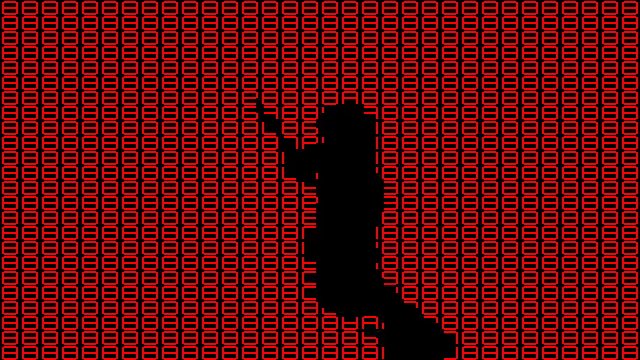

<h1 align="center">7segmentSeriousDisplay</h1>

<p align="center">
  <a href="README.en.md">English</a> |
  <a href="README.md">Polski</a>
</p>

<p align="center">
  Video playback on a MAX7219 7-segment display matrix driven by a Raspberry Pi.
</p>

The project converts video frames into 7-segment states and sends them from a PC over UART to a Raspberry Pi. The Raspberry Pi receives the frames and drives MAX7219 modules over SPI. The PC app also has a `display` mode that shows the result locally, without any hardware.

```text
video → uart_app (PC) → UART → firmware (Raspberry Pi) → MAX7219
```

## Requirements

- Linux with a C++17 compiler, `make`, and `pkg-config`
- OpenCV, SDL2, and FFmpeg
- for firmware: a Raspberry Pi with SPI enabled and libgpiod 1.x
- for transmission: a UART port, e.g. `/dev/ttyUSB0` or `/dev/serial0`

## Download and dependency check

```sh
git clone https://github.com/Proszony/7segmentSeriousDisplay.git
cd 7segmentSeriousDisplay

make check-deps
```

`make check-deps` installs nothing — it prints missing modules and a ready-to-use install command for the detected distribution.

Main packages:

| Distribution | Command |
|---|---|
| Arch / Manjaro | `sudo pacman -S --needed pkgconf opencv sdl2 ffmpeg` |
| Debian / Ubuntu / Raspberry Pi OS | `sudo apt install pkg-config libopencv-dev libsdl2-dev libavformat-dev libavcodec-dev libavutil-dev libswresample-dev` |
| Fedora / RHEL | `sudo dnf install pkgconf-pkg-config opencv-devel SDL2-devel ffmpeg-devel` (FFmpeg from RPM Fusion) |

OpenCV is detected as `opencv5` or `opencv4`. You can force the choice with `make OPENCV_PC=opencv4`.

## Building and running

```sh
make
make check-runtime
./uart_app/build/app --help
```

`make` builds the app into `uart_app/build/app`, and `make check-runtime` checks for missing runtime libraries.

| Mode | Description |
|---|---|
| `display` | display preview without hardware |
| `send` | send video from the PC over UART |
| `receive` | receive UART frames and preview them on the PC |

Examples run from the repository root:

```sh
# preview without hardware
./uart_app/build/app -m display -d -i "res/BadApple!!.mp4"

# send to a Raspberry Pi
./uart_app/build/app -m send -p /dev/ttyUSB0 -b 115200 -i "res/BadApple!!.mp4"

# receive and preview frames
./uart_app/build/app -m receive -p /dev/ttyUSB0 -d
```

## Display mode



`display` mode renders video as a grid of 7-segment displays. By default it uses `32×24` segments and the color red.

| Flag | Meaning |
|---|---|
| `-i, --input <file>` | input video file |
| `-res <w,h>` | working resolution |
| `-div <nx,ny>` | number of segments along the X/Y axes |
| `-th <0..1>` | brightness threshold |
| `-inv` | invert brightness |
| `-c <r,g,b>` | segment color |
| `-rot <0,90,180,270>` | rotate the image |
| `-fps <n>` | FPS limit (`-1` = automatic) |
| `-a` | play audio |
| `-d` | show the preview window |

## Firmware on Raspberry Pi

The firmware receives frames over UART and refreshes MAX7219 modules. It is built on the Raspberry Pi:

```sh
make -C firmware
sudo ./firmware/display --chips 3 --mod-y 2 --cs-pins 25,26
```

Main options: `--port` (default `/dev/serial0`), `--baud`, `--chips` (MAX7219 chips per module), `--mod-x`, `--mod-y`, and `--cs-pins`. Settings can also be stored in `config.cfg` in the `KEY=VALUE` format; CLI flags take precedence.

## Tests

Tests are split into **host** tests (no hardware) and **hardware** tests (Raspberry Pi).

### Host tests

They do not require a Raspberry Pi, SPI, GPIO, or a serial port. Only a C++17 compiler and `make` are needed.

```sh
make test              # build and run all host tests
make -C test unit      # build only
make -C test run-unit  # build and run
```

| Test | What it checks |
|---|---|
| `test_uart` | `UART::open/close/write/read`, timeouts, and bidirectional traffic over a pseudo-terminal (PTY) |
| `test_framing` | `create_frame`, `serialize`, `deserialize`: frame layout, serialization/deserialization, invalid data |
| `test_config` | `config.cfg` parser: defaults, keys, comments, `cs-pins` |

Exit code `0` means success, `1` means at least one failed assertion.

Individual tests can be run directly from `test/bin/`:

```sh
./test/bin/test_uart
./test/bin/test_framing
./test/bin/test_config
```

### Hardware tests

Run on a Raspberry Pi with SPI enabled and `libgpiod` 1.x:

```sh
make test-hardware
```

| Test | What it checks | Requirements |
|---|---|---|
| `test_daisy_cs` | visually checks MAX7219: each chip, each digit, hex 0–F, individual segments | SPI, connected MAX7219 modules, CS on GPIO 25 |

Individually:

```sh
./test/bin/test_daisy_cs --chips 1     # a single 8x1 display
./test/bin/test_daisy_cs --chips 3     # a single module (three 8x1 displays)
```

### Cleaning

```sh
make -C test clean
```

## Project structure

```text
uart_app/    PC app: send, receive, and display modes
firmware/    UART receiver and MAX7219 control on Raspberry Pi
test/        host and hardware tests (uart_test, firmware_test)
simulation/  older standalone simulation version
res/         sample video files
scripts/     dependency check script
docs/        images used in the README
```

## License

This project is released under the [AGPL-3.0](LICENSE) license.
