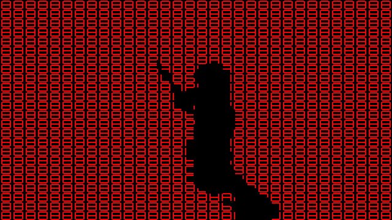

<h1 align="center">7segmentSeriousDisplay</h1>

<p align="center">
  <a href="README.md">Polski</a> |
  <a href="README.en.md">English</a>
</p>

<p align="center">
  Odtwarzanie wideo na matrycy wyświetlaczy 7-segmentowych MAX7219 sterowanej przez Raspberry Pi.
</p>

Projekt zamienia klatki wideo na stany segmentów 7-segmentowych i przesyła je z komputera przez UART do Raspberry Pi. Raspberry Pi odbiera ramki i steruje modułami MAX7219 przez SPI. Aplikacja na PC ma też tryb `display`, który pokazuje wynik lokalnie, bez podłączania sprzętu.

```text
wideo → uart_app (PC) → UART → firmware (Raspberry Pi) → MAX7219
```

## Wymagania

- Linux z kompilatorem C++17, `make` i `pkg-config`
- OpenCV, SDL2 i FFmpeg
- do firmware: Raspberry Pi z włączonym SPI oraz libgpiod 1.x
- do transmisji: port UART, np. `/dev/ttyUSB0` lub `/dev/serial0`

## Pobranie i sprawdzenie zależności

```sh
git clone https://github.com/Proszony/7segmentSeriousDisplay.git
cd 7segmentSeriousDisplay

make check-deps
```

`make check-deps` niczego nie instaluje — wypisuje brakujące moduły i gotowe polecenie instalacji dla wykrytej dystrybucji.

Najważniejsze pakiety:

| Dystrybucja | Polecenie |
|---|---|
| Arch / Manjaro | `sudo pacman -S --needed pkgconf opencv sdl2 ffmpeg` |
| Debian / Ubuntu / Raspberry Pi OS | `sudo apt install pkg-config libopencv-dev libsdl2-dev libavformat-dev libavcodec-dev libavutil-dev libswresample-dev` |
| Fedora / RHEL | `sudo dnf install pkgconf-pkg-config opencv-devel SDL2-devel ffmpeg-devel` (FFmpeg z RPM Fusion) |

OpenCV jest wykrywany jako `opencv5` lub `opencv4`. Wybór można wymusić przez `make OPENCV_PC=opencv4`.

## Budowanie i uruchomienie

```sh
make
make check-runtime
./uart_app/build/app --help
```

`make` buduje aplikację do `uart_app/build/app`, a `make check-runtime` sprawdza, czy nie brakuje bibliotek ładowanych w czasie działania.

| Tryb | Opis |
|---|---|
| `display` | podgląd wyświetlacza bez sprzętu |
| `send` | wysyłanie wideo z PC przez UART |
| `receive` | odbiór ramek UART i podgląd na PC |

Przykłady uruchamiane z katalogu głównego repozytorium:

```sh
# podgląd bez sprzętu
./uart_app/build/app -m display -d -i "res/BadApple!!.mp4"

# wysyłanie na Raspberry Pi
./uart_app/build/app -m send -p /dev/ttyUSB0 -b 115200 -i "res/BadApple!!.mp4"

# odbiór i podgląd ramek
./uart_app/build/app -m receive -p /dev/ttyUSB0 -d
```

## Tryb display



Tryb `display` renderuje wideo jako siatkę wyświetlaczy 7-segmentowych. Domyślnie używane jest `32×24` segmentów i czerwony kolor.

| Flaga | Znaczenie |
|---|---|
| `-i, --input <plik>` | plik wideo wejściowego |
| `-res <w,h>` | rozdzielczość robocza |
| `-div <nx,ny>` | liczba segmentów w osiach X/Y |
| `-th <0..1>` | próg jasności |
| `-inv` | odwrócenie jasności |
| `-c <r,g,b>` | kolor segmentów |
| `-rot <0,90,180,270>` | obrót obrazu |
| `-fps <n>` | limit FPS (`-1` = automatycznie) |
| `-a` | odtwarzanie dźwięku |
| `-d` | pokazanie okna podglądu |

## Firmware na Raspberry Pi

Firmware odbiera ramki z UART i odświeża moduły MAX7219. Buduje się na Raspberry Pi:

```sh
make -C firmware
sudo ./firmware/display --chips 3 --mod-y 2 --cs-pins 25,26
```

Podstawowe opcje: `--port` (domyślnie `/dev/serial0`), `--baud`, `--chips` (MAX7219 na moduł), `--mod-x`, `--mod-y` i `--cs-pins`. Ustawienia można też zapisać w `config.cfg` w formacie `KEY=VALUE`; flagi CLI mają pierwszeństwo.

## Testy

Testy dzielą się na **hosta** (bez sprzętu) i **sprzętowe** (Raspberry Pi).

### Testy hosta

Nie wymagają Raspberry Pi, SPI, GPIO ani portu szeregowego. Potrzebny jest tylko kompilator C++17 i `make`.

```sh
make test              # zbuduj i uruchom wszystkie testy hosta
make -C test unit      # tylko zbudowanie
make -C test run-unit  # zbudowanie + uruchomienie
```

| Test | Co sprawdza |
|---|---|
| `test_uart` | `UART::open/close/write/read`, timeouty i ruch dwukierunkowy na pseudo-terminalu (PTY) |
| `test_framing` | `create_frame`, `serialize`, `deserialize`: układ ramki, serializacja/deserializacja, błędne dane |
| `test_config` | parser `config.cfg`: wartości domyślne, klucze, komentarze, `cs-pins` |

Kod wyjścia `0` oznacza sukces, `1` oznacza co najmniej jedną nieudaną asercję.

Pojedyncze testy można uruchomić bezpośrednio z `test/bin/`:

```sh
./test/bin/test_uart
./test/bin/test_framing
./test/bin/test_config
```

### Testy sprzętowe

Uruchamia się na Raspberry Pi z włączonym SPI oraz `libgpiod` 1.x:

```sh
make test-hardware
```

| Test | Co sprawdza | Wymagania |
|---|---|---|
| `test_daisy_cs` | wizualnie MAX7219: każdy chip, każda cyfra, hex 0–F, pojedyncze segmenty | SPI, podłączone MAX7219, CS na GPIO 25 |

Pojedynczo:

```sh
./test/bin/test_daisy_cs --chips 1     # pojedynczy wyświetlacz 8x1
./test/bin/test_daisy_cs --chips 3     # pojedynczy moduł (trzy wyświetlacze 8x1)
```

### Czyszczenie

```sh
make -C test clean
```

## Struktura projektu

```text
uart_app/    aplikacja PC: tryby send, receive i display
firmware/    odbiornik UART i sterowanie MAX7219 na Raspberry Pi
test/        testy hosta i sprzętowe (uart_test, firmware_test)
simulation/  starsza, samodzielna wersja symulacji
res/         przykładowe pliki wideo
scripts/     skrypt sprawdzający zależności
docs/        grafiki używane w README
```

## Licencja

Projekt jest udostępniany na licencji [AGPL-3.0](LICENSE).
